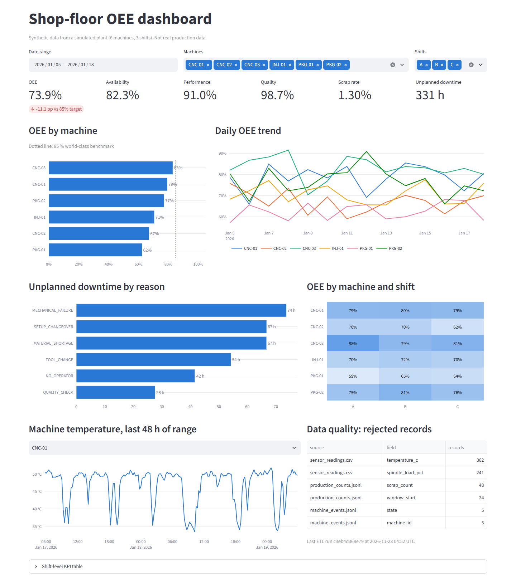
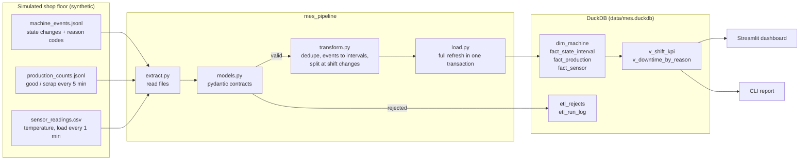

# MES Data Pipeline: shop-floor data to OEE

[](https://github.com/tdathuynh/mes-data-pipeline/actions/workflows/ci.yml)


A small, end-to-end data engineering project for manufacturing. It simulates the raw data a
Manufacturing Execution System (MES) receives from the shop floor, then validates it, transforms
it, loads it into DuckDB and computes the standard production KPIs: **OEE** (availability,
performance, quality), downtime by reason and scrap rate, per machine and per shift. A Streamlit
dashboard shows the results.

> **All data in this repository is synthetic.** It comes from a seeded random model in
> [`simulator.py`](src/mes_pipeline/simulator.py). No real plant, customer or employer data or code
> is used. The project is a personal portfolio piece based on general MES domain knowledge.



## The problem

On a real shop floor, machine data arrives from PLCs, SCADA gateways and sensor historians in
different shapes. It is often messy: duplicate messages, events arriving late, typos from
hand-configured gateways, sensor fault codes, counters that go negative. Before anyone can trust
an OEE number, the pipeline has to:

1. **ingest** several feeds in different formats (JSON Lines and CSV),
2. **validate** every record against a contract and keep the rejects visible instead of dropping them,
3. **turn state-change events into time intervals** and split them at shift boundaries, so every
   second of the day is counted once, in the right shift,
4. **compute KPIs correctly**: ratios are recalculated from summed times and counts, never averaged.

## Architecture



| Layer | What it does |
|---|---|
| [`simulator.py`](src/mes_pipeline/simulator.py) | 6 machines (CNC, injection molding, packaging), 3 shifts. Random run/stop spells, weighted stop reasons, mid-shift breaks, weekly planned maintenance, temperature that follows machine state. Optionally injects data-quality defects. |
| [`models.py`](src/mes_pipeline/models.py) | Pydantic v2 models. Checks types, ranges (temperature, non-negative counters), known machine IDs, and business rules (a `DOWN` event needs an unplanned reason code, `RUNNING` must not have one). |
| [`extract.py`](src/mes_pipeline/extract.py) | Streams the files, validates every row, and records each reject with source file, line number and reason. |
| [`transform.py`](src/mes_pipeline/transform.py) | Removes duplicate events, sorts them per machine, converts events to intervals, splits intervals at 06:00 / 14:00 / 22:00, and tags counts and sensor rows with their shift. |
| [`load.py`](src/mes_pipeline/load.py) | Writes everything to DuckDB in one transaction (re-runs are idempotent), appends to `etl_run_log`, and creates the KPI views. |
| [`kpi.py`](src/mes_pipeline/kpi.py) | KPI formulas as pure Python functions **and** as SQL views. Tests check that both agree. |
| [`dashboard/app.py`](dashboard/app.py) | Streamlit + Plotly: KPI tiles, OEE by machine, daily trend, downtime by reason, machine x shift heatmap, temperature drill-down, data-quality panel. |

DuckDB was chosen because it runs in-process with zero setup, yet supports the analytical SQL
(`FILTER` aggregates, `GROUP BY ALL`, `time_bucket`) you would also write against PostgreSQL or a
cloud warehouse.

## Quick start

Requires Python 3.10+.

```bash
python -m venv .venv && source .venv/bin/activate      # Windows: .venv\Scripts\activate
pip install -e ".[dashboard,dev]"
mes-pipeline demo                                       # simulate 14 days, run ETL, print KPIs
streamlit run dashboard/app.py                          # open http://localhost:8501
```

Example output of `mes-pipeline demo` (seed 42):

```text
                 source  rows_read  rows_valid  rows_rejected
   machine_events.jsonl       2657        2647             10
production_counts.jsonl      24192       24120             72
    sensor_readings.csv     120960      120357            603
duplicates removed: 26

OEE by machine
machine_id  availability  performance  quality   oee  scrap_rate
    CNC-01         85.3%        94.8%    98.1% 79.3%        1.9%
    CNC-02         79.4%        88.2%    95.9% 67.2%        4.1%
    CNC-03         89.1%        94.5%    98.6% 83.0%        1.4%
    INJ-01         81.6%        89.9%    96.3% 70.6%        3.7%
    PKG-01         74.5%        84.8%    98.8% 62.5%        1.2%
    PKG-02         83.6%        92.9%    99.3% 77.1%        0.7%

Plant OEE: 73.9%
```

Individual steps:

```bash
mes-pipeline simulate --days 30 --seed 7 --out data/raw   # add --clean for defect-free data
mes-pipeline run --raw data/raw --db data/mes.duckdb
mes-pipeline report --db data/mes.duckdb
```

The database can also be queried directly, for example the top downtime reasons per machine:

```sql
SELECT machine_id, reason_code, sum(stops) AS stops, round(sum(duration_s) / 3600, 1) AS hours
FROM v_downtime_by_reason
WHERE state = 'DOWN'
GROUP BY ALL
ORDER BY hours DESC
LIMIT 10;
```

## KPI definitions

All KPIs are computed per **machine x shift** in the view `v_shift_kpi`.

| Term | Definition |
|---|---|
| Scheduled time | Time covered by state intervals in the shift (8 h for a full shift) |
| Planned stop time | Time in `PLANNED_STOP` (breaks, planned maintenance) |
| **Planned production time** | Scheduled time - planned stop time |
| Run time | Time in `RUNNING` |
| Unplanned downtime | Time in `DOWN`, broken down by reason code |
| Total count | Good count + scrap count |
| **Availability** | Run time / planned production time |
| **Performance** | (Ideal cycle time x total count) / run time, capped at 100 % |
| **Quality** | Good count / total count |
| **OEE** | Availability x Performance x Quality, which equals (good count x ideal cycle time) / planned production time |
| Scrap rate | Scrap count / total count |

Design decisions:

- **Ratios are never averaged.** Rolling up to a machine, a day or the plant sums the times and
  counts first and then recomputes the ratios ([`aggregate_kpis`](src/mes_pipeline/kpi.py)). An
  average of per-shift OEE would weight a short, half-empty shift the same as a full one.
- **Performance is capped at 100 %.** A value above 100 % means a wrong ideal cycle time or a
  counter problem; capping keeps OEE meaningful while the root cause is fixed.
- **Undefined ratios are `NULL`, not 0.** A shift with no planned production time has no
  availability, which is different from 0 % availability.
- **Night shift C belongs to the date it starts on** (22:00 Monday to 06:00 Tuesday is Monday's
  shift C). Intervals that cross 06:00, 14:00 or 22:00 are split so each piece lands in the
  correct shift.

## Data quality

With defects enabled (the default), the simulator corrupts a small, controlled share of records.
The pipeline catches them and stores them in `etl_rejects`:

| Defect | Where | How it is handled |
|---|---|---|
| Duplicate messages (at-least-once delivery) | events | removed by `event_id` in transform |
| Late / out-of-order events | events | sorted by machine and timestamp |
| Unknown machine `CNC-99` | events | rejected: not in master data |
| State typo `RUNNNING` | events | rejected: not a valid enum value |
| Negative scrap counter | counts | rejected: must be >= 0 |
| Missing timestamp | counts | rejected |
| Sensor fault code `999.9 °C` | sensors | rejected: outside the physical range |
| Empty sensor value | sensors | rejected |

## Tests and quality checks

```bash
pytest                  # KPI math, SQL vs Python, validation rules, shift logic, end-to-end
ruff check . && ruff format --check .
mypy                    # strict type checking of src/
```

GitHub Actions runs all of these on Python 3.10 and 3.12 for every push and pull request.

Tests worth reading:

- [`test_kpi.py`](tests/test_kpi.py): a hand-calculated shift (OEE exactly 80 %), the OEE identity,
  the performance cap, and a check that SQL views and Python functions give the same numbers.
- [`test_transform.py`](tests/test_transform.py): shift assignment around midnight and year end,
  vectorised and scalar shift logic agree, interval splitting keeps the total duration.
- [`test_pipeline.py`](tests/test_pipeline.py): every scheduled second ends up as planned stop,
  run time or downtime; re-running the pipeline does not duplicate data.

## Project layout

```text
src/mes_pipeline/   config, simulator, models, extract, transform, load, kpi, pipeline, cli
dashboard/app.py    Streamlit dashboard
tests/              pytest suite
docs/               screenshot
```

## Possible next steps

- Incremental loads (watermark on event time) instead of a full refresh.
- Run on PostgreSQL / TimescaleDB with `docker compose`, keeping the same SQL views.
- Orchestration with Airflow or Dagster.
- Shift calendars and production orders per machine instead of a fixed 3-shift pattern.

## License

MIT. See [LICENSE](LICENSE).
